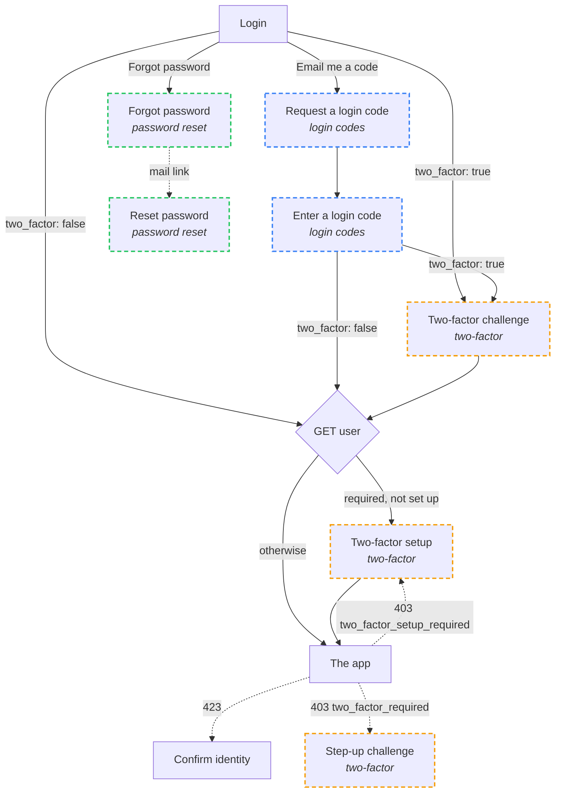

# Screens

The package ships no views: every authentication screen belongs to the frontend. This page lists the screens an app needs, when each is needed, which endpoints it calls and what it must and must not show. The [frontend guide](frontend.md) has the requests and responses of every flow; this page links to it rather than repeating them.

With [Nova](nova.md) installed, Nova's own login, challenge, password reset and User Security screens cover the Nova panel. The app's own frontend still needs the screens below.

## Which screens to build

Only a few screens are always needed. The rest belong to a feature, and an app builds them only when it turns that feature on.

| Feature | Turned on by | Default |
|---|---|---|
| Login codes | `LoginCodeAuthenticatable` (with the `AuthenticatesWithLoginCode` trait) on the user model. See [Login codes](login-codes.md). | Off |
| Login code link in the mail | `login_codes.link_url` (`AUTH_LOGIN_CODE_URL`), on top of login codes. | Off |
| Two-factor authentication | Fortify's `twoFactorAuthentication` feature in `config/fortify.php`, and `TwoFactorAuthenticatable` on the user model. See [Two-factor authentication](two-factor-authentication.md). | Off until the model implements the contract; Fortify's published config has the feature on |
| Required two-factor authentication | `two_factor.required`, on top of two-factor authentication. | On once two-factor authentication is on |
| Password reset | Fortify's `resetPasswords` feature in `config/fortify.php`. | On in Fortify's published config |
| Password change | Fortify's `updatePasswords` feature in `config/fortify.php`. | On in Fortify's published config |

| Screen | Needed | Endpoints |
|---|---|---|
| [Login](#login) | Always | `POST auth/login` |
| [Confirm identity](#confirm-identity) (dialog) | Always | `POST user/confirm-password`, `POST user/confirm-password/code` |
| [Security settings](#security-settings) | Always, with sections per feature | `user/sessions`, plus the endpoints of its feature sections |
| [Request a login code](#request-a-login-code) | With login codes | `POST auth/login-code` |
| [Enter a login code](#enter-a-login-code) | With login codes; it is also where the mail's link lands when `login_codes.link_url` is set | `POST auth/login` |
| [Two-factor challenge](#two-factor-challenge) | With two-factor authentication | `POST auth/two-factor-challenge` |
| [Two-factor setup](#two-factor-setup) | With two-factor authentication; right after login only when it is required | `user/two-factor-*`, `user/confirmed-two-factor-authentication` |
| [Step-up challenge](#step-up-challenge) (dialog) | With two-factor authentication | `POST auth/two-factor-challenge` |
| [Forgot password](#forgot-password) | With password reset | `POST auth/forgot-password` |
| [Reset password](#reset-password) | With password reset | `POST auth/reset-password` |

Ask the backend which features are on. A frontend that serves several apps can't read them from the API up front; it can only infer some of them from `GET user` (`two_factor_required`, `confirmation_method`) after login.

## How the screens connect

The diagram shows every screen in one flow. A screen with a plain border is always there. A screen with a dashed, coloured border belongs to the feature in italics under its name (blue: login codes, orange: two-factor authentication, green: password reset). Leave those screens out, with the arrows into them, when the feature is off. With no feature on, what is left is Login, `GET user`, the app and Confirm identity.

- **Logging in.** The login (with a password, or with a code from the login codes screens) answers `two_factor: true` when the device must pass the two-factor challenge, else `two_factor: false`. After both, call `GET user` and route on it: with required two-factor authentication, a user who hasn't set it up goes to the setup screen before the app.
- **Password reset.** The reset mail opens the reset page; after the reset, the user goes back to the login.
- **While using the app** (dotted arrows). Any request of the app can answer 423, and with two-factor authentication also 403 `two_factor_required` or 403 `two_factor_setup_required`. Handle them in one place in the HTTP client: open the dialog or screen, then retry the request.

## Login

Fields: email, password, "remember me" (session mode only). Links: "Forgot password" with password reset, and "Email me a code" with login codes. Flow: [Log in with a password](frontend.md#log-in-with-a-password).

- Show one generic message for a wrong email or password (the 422 on `errors.email`). Never say which of the two was wrong.
- On 429, disable the button for the `Retry-After` seconds.
- The password field also accepts a login code: the backend decides per user which works. A user without a password can type the code from their mail here.
- Token mode: send the stored device token as `X-Two-Factor-Device`, and a recognisable `device_name`.

## Request a login code

Field: email. Flow: [Log in with an emailed code](frontend.md#log-in-with-an-emailed-code).

- The route answers 202 with the same message for every address, also for unknown ones and when it is rate-limited. Show that message, or "If the address is known, we sent a code", and go to the code screen. Never show anything that tells whether the account exists.

## Enter a login code

Fields: email (prefilled from the previous screen), code. It posts the code as the `password` of `POST auth/login`, so its answers are the login's, including the two-factor challenge.

- Offer "Send a new code", back to the request screen.
- When the backend sets `login_codes.link_url`, this screen is also where the mail's link lands, with `email` and `code` in the URL. Prefill both and let the user press the button; don't post on page load. Mail scanners open links in mails, and an automatic post would use up the code's attempts before the user does.

## Two-factor challenge

Field: a six-digit code from the authenticator app, with a switch to a recovery code. Checkbox: "Remember this device". Flow: [Pass the two-factor challenge](frontend.md#pass-the-two-factor-challenge).

- Send `code` or `recovery_code`, never both. Tell the user a recovery code works once.
- Token mode: send the `challenge` id from the login as `X-Auth-Challenge`, and store the `device_token` from the answer when it isn't `null`.
- A 422 is a wrong code or an expired challenge. After an expired token-mode challenge (about ten minutes), send the user back to the login.
- Use `inputmode="numeric"` and `autocomplete="one-time-code"` on the code field.

## Forgot password

Field: email. Flow: [Forgot and reset password](frontend.md#forgot-and-reset-password).

- The route answers the same for every valid address. Show its message; never say whether a mail was sent.

## Reset password

Opened from the reset mail's link, at the URL the backend sets in `passwords.reset_url` (`AUTH_PASSWORD_RESET_URL`), with `token` and `email` in the query string. Fields: new password, confirmation; the token and email come from the URL.

- 422 `errors.email` means the link is invalid or expired: offer "Request a new link".
- 422 `errors.password` lists the password rules that failed; show them next to the field.
- The reset doesn't log the user in. Send them to the login with a success message.

## Two-factor setup

A screen with steps, reached right after login when two-factor authentication is required, and from the security settings. Flow: [Set up two-factor authentication](frontend.md#set-up-two-factor-authentication).

1. Enable: `POST user/two-factor-authentication`. It needs a recent identity confirmation, so it can open the [confirm identity](#confirm-identity) dialog first.
2. Scan: show the QR code (`svg`), a link with the `otpauth://` URL for an app on the same device, and the secret key to type in.
3. Confirm: a code from the app. Until this succeeds, two-factor authentication isn't on.
4. Recovery codes: show them once, with copy and download, and ask the user to store them before leaving the screen.

While two-factor authentication is required and not set up, every other route of the app answers 403 `two_factor_setup_required`: don't show the app's navigation on this screen, only the setup and logout.

## Confirm identity

A dialog, opened when a request answers 423, or up front when `GET user/confirmed-password-status` returns `confirmed: false`. Flow: [Confirm the user's identity](frontend.md#confirm-the-users-identity).

Pick the variant from `confirmation_method` on `GET user`. The password variant is always needed; build the others for the features that are on:

| `confirmation_method` | The dialog asks for |
|---|---|
| `password` | The password. |
| `totp` | A code from the authenticator app. Only with two-factor authentication. |
| `login_code` | An emailed code: a "Send code" button (`POST user/confirm-password/code`), then the code. Only with login codes. |
| `null` | Nothing: the user can't confirm. Explain that the action isn't available. |

After a 201, close the dialog and retry the request that answered 423.

## Step-up challenge

A dialog, opened when a request answers 403 `two_factor_required`: the user is logged in, but this device's two-factor trust ended. It is the [two-factor challenge](#two-factor-challenge) without `X-Auth-Challenge`, sent with the session or bearer token. Flow: [Handle required two-factor authentication](frontend.md#handle-required-two-factor-authentication).

After it passes, store the `device_token` (token mode) and retry the request.

## Security settings

One page, or one per section, inside the app. Only the sessions section is always there; the others belong to a feature. Every change here needs a recent identity confirmation, so expect 423 and open the [confirm identity](#confirm-identity) dialog.

- **Password** (with password change). Current password, new password and confirmation. Flow: [Change password](frontend.md#change-password). Show this section only when `confirmation_method` is `password`; a user without a password gets 403 `password_unavailable`.
- **Two-factor authentication** (with two-factor authentication). Whether it is on (`two_factor_enabled`); set up opens the [setup screen](#two-factor-setup). When it is on: show and regenerate the recovery codes, and turn it off. Hide "turn off" when `two_factor_required` is `true`.
- **Devices** (with two-factor authentication). The devices that skip the challenge (`GET user/devices`), each with a remove button. Mark the row with `is_current`.
- **Sessions** (always). The browser sessions and access tokens (`GET user/sessions`), each with a revoke button, and "Log out everywhere else". Hide the revoke button on the row with `is_current`; that one is ended with logout, and revoking it answers 403 `current_session`.

Flow: [Manage devices and sessions](frontend.md#manage-devices-and-sessions).

## Texts

The `message` of every error is translated in the app's language and can be shown as it is. To use your own texts, map the 403 `code` and the 422 field names; never parse `message`. The full list is in [Errors](frontend.md#errors). The texts of the mails that lead to these screens are in [Mails](mails.md).
